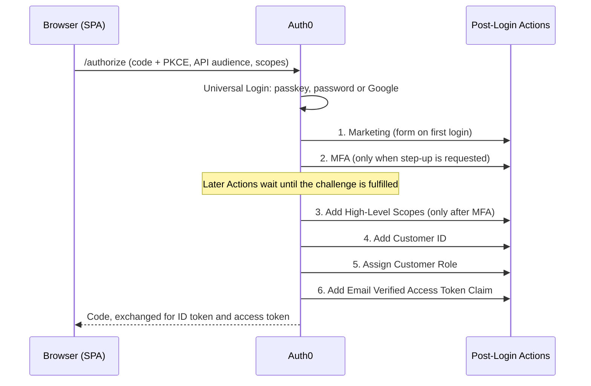

# Pizza 42: Auth0 tenant configuration

Auth0 tenant configuration for the Pizza 42 demo, kept as code and exported with the [Auth0 Deploy CLI](https://auth0.com/docs/deploy-monitor/deploy-cli-tool). It contains the post-login Actions, the marketing Form, the clients, the API, the customer role and the MFA settings that the two application repos depend on.

## Related repositories

| Repository | Purpose |
|---|---|
| [pizza-42](https://github.com/MattM-1/pizza-42) | Angular single-page app (login, menu, orders, profile) |
| [pizza-42-api](https://github.com/MattM-1/pizza-42-api) | Express orders API that validates Auth0 access tokens and scopes |
| **this repo** | Tenant configuration the two apps rely on |

## What is configured here

| Folder / file | Contents |
|---|---|
| `actions/` | Post-login Actions (code in `<name>/code.js`, settings in `<name>.json`) |
| `triggers/triggers.json` | Order in which the Actions run in the Login flow |
| `forms/` | *Marketing communication preferences* Form shown on first login |
| `clients/` | **Pizza 42** SPA, **Assign Customer Role M2M** (Management API access for the role Action), Deploy CLI client, test application |
| `resource-servers/` | **Pizza 42 API** (`https://api.pizza42.example.com`) and its permissions |
| `roles/` | `customer` role (`create:orders`, `read:orders`) |
| `grants/` | Client grants, including the M2M client's Management API grant (`update:users`) |
| `connections/`, `database-connections/` | Google social login and the username/password database |
| `guardian/` | MFA factor settings (TOTP, email, WebAuthn platform) |
| `prompts/` | Universal Login settings, including identifier-first and passkeys |
| `tenant.json` | Tenant settings, including *Customize MFA Factors using Actions* |

Folders such as `organizations/`, `themes/` and `log-streams/` come from the Deploy CLI export and are not used by this demo.

## Post-login Actions

The Actions run in this order for every login (see `triggers/triggers.json`):

| # | Action | Purpose |
|---|---|---|
| 1 | **Marketing** | On first login, shows the marketing Form and stores the answer in `app_metadata.marketing_opt_in`. On every login, adds the opt-in claim to the ID token and the access token. |
| 2 | **MFA** | When the app requests step-up (`acr_values` = multi-factor), it marks the login transaction (`mfa_triggered`) and challenges the user (TOTP or email), or enrolls TOTP if they have no second factor. All MFA is triggered through one `requireMfa()` function. |
| 3 | **Add High-Level Scopes** | Adds `create:large-orders` to the access token only when the MFA Action marked this transaction **and** an `otp` or `email` MFA method was completed. Silent token renewals never get the scope. |
| 4 | **Add Customer ID** | Creates a unique `pizza42_customer_id` once, stores it in `app_metadata`, and adds it as a claim to the ID and access tokens. |
| 5 | **Assign Customer Role** | Gives new users the `customer` role through the Management API and adds the base scopes (`create:orders`, `read:orders`) to that first login's token. |
| 6 | **Add Email Verified Access Token Claim** | Adds the standard `email_verified` claim to the access token so the API can require a verified email. |



### Claims these Actions add

| Claim | Token | Action |
|---|---|---|
| `https://pizza42.example.com/marketing` (`{ marketing_opt_in }`) | ID | Marketing |
| `https://pizza42.example.com/marketing_opt_in` (boolean) | Access | Marketing |
| `https://pizza42.example.com/customer_id` | ID and access | Add Customer ID |
| `scope` includes `create:large-orders` | Access | Add High-Level Scopes |
| `scope` includes `create:orders read:orders` (first login) | Access | Assign Customer Role |
| `email_verified` (standard, not namespaced) | Access | Add Email Verified Access Token Claim |

Custom claims use the namespace `https://pizza42.example.com/`, which must match `claimsNamespace` in the SPA and
`CLAIMS_NAMESPACE` in the API. Standard OIDC profile claims such as `email_verified` are allowed on API access tokens without one.

## How the pieces fit together

- The SPA requests the Pizza 42 API audience with `create:orders read:orders`.
- The API checks the token's signature, issuer, audience and expiry, then checks one scope per endpoint and the `email_verified` claim on orders.
- `create:large-orders` is defined on the API but is **not** part of the `customer` role. Only the Actions above can add it, and only after MFA in that same login, so the scope itself is proof of step-up.

## Required settings and secrets

- **Tenant setting:** *Customize MFA Factors using Actions* must be on (`customize_mfa_in_postlogin_action` in `tenant.json`). Without it the MFA Action fails.
- **Action secrets** for *Assign Customer Role* (`DOMAIN`, `CLIENT_ID`, `CLIENT_SECRET`) are not stored in this repo. Set them in the Auth0 dashboard under the Action. They are the credentials of the **Assign Customer Role M2M** client.
- **M2M grant:** the M2M client needs the Auth0 Management API scope `update:users` (defined in `grants/`).
- **`config.json`** holds the Deploy CLI credentials and is git-ignored. Never commit it.

## Using the Deploy CLI

Create `config.json` (git-ignored) with an Auth0 client that has Management API access:

```json
{
  "AUTH0_DOMAIN": "your-tenant.us.auth0.com",
  "AUTH0_CLIENT_ID": "...",
  "AUTH0_CLIENT_SECRET": "...",
  "AUTH0_ALLOW_DELETE": false
}
```

Then, from the repository root:

```bash
npm install

# Pull the current tenant configuration into this repo
npx a0deploy export -c config.json -f directory -o .

# Push this repo's configuration to the tenant
npx a0deploy import -c config.json -f directory -i .
```

`AUTH0_ALLOW_DELETE` is `false`, so an import never deletes tenant resources that aren't in the repo.

## Setting up another tenant

1. Create the Deploy CLI client and `config.json` for the new tenant.
2. Update tenant-specific values: the tenant domain in `grants/`, the role ID referenced by *Assign Customer Role*, the form ID referenced by *Marketing*, and the Google OAuth client credentials.
3. Run the import, then set the Action secrets and the Google connection credentials in the dashboard.
4. Add the app's URLs to the **Pizza 42** client's callback, logout and web-origin lists.
